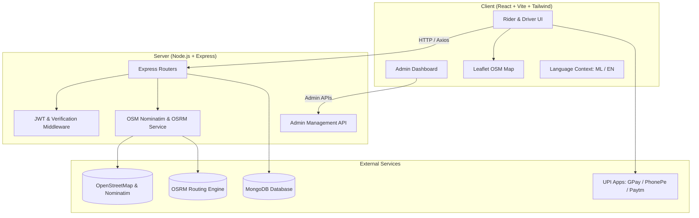

# 🛺 EyAuto 1.0 — Hyperlocal Auto-Rickshaw Booking Platform
> **വളാഞ്ചേരിയുടെ സ്വന്തം ഓട്ടോ ബുക്കിംഗ് പ്ലാറ്റ്‌ഫോം**  
> An open-source, hyperlocal on-demand auto-rickshaw & cab hailing solution tailored for Valanchery, Kerala.

[-61DAFB?logo=react&logoColor=black)](https://react.dev/)
[](https://nodejs.org/)
[](https://www.openstreetmap.org/)
[](https://tailwindcss.com/)
[](https://github.com/)
[](https://github.com/)
[](https://opensource.org/licenses/MIT)

---

## 📖 About EyAuto (പദ്ധതിയെക്കുറിച്ച്)

Commercial ride-hailing aggregators are often unsuited for regional semi-urban towns in Kerala due to exorbitant map licensing costs, lack of local auto stand coordination, and language barriers.

Originally conceptualized and developed as a **Final Year B.Sc. Computer Science Academic Project** at **KRS Sree Narayana College, Valanchery**, **EyAuto** was born out of a real-world local necessity: empowering local auto-rickshaw drivers and daily commuters with an accessible, technology-driven hailing platform.

**EyAuto 1.0** is purpose-built for **Valanchery (വളാഞ്ചേരി), Malappuram**:
- **100% Free & Open-Source Maps**: Completely free of Google Maps API dependencies and costs, using **OpenStreetMap**, **Leaflet**, and **OSRM**.
- **Hyperlocal Pricing**: Configured with standard Kerala Auto-rickshaw base fares and per-kilometer rates.
- **Bilingual Interface**: Native support for **Malayalam (മലയാളം)** and **English** so local passengers and auto drivers can use it effortlessly.

---

## ✨ Key Features (പ്രധാന ഫീച്ചറുകൾ)

### 1. 🗺️ Zero-Cost OpenStreetMap & Leaflet Integration
- **Places Autocomplete**: Debounced, real-time address search powered by OpenStreetMap Nominatim.
- **Live Road Routing (OSRM)**: Real-time route calculation and interactive polyline display connecting pickup and drop-off points.
- **Accurate Distance & Fare Engine**: Computes travel distance, duration, and transparent auto fares without proprietary map API keys.

### 2. 🛡️ 4-Digit Ride Start Security PIN
- When a passenger books an auto, a secure **4-digit one-time PIN** is generated.
- The driver must enter and verify this PIN on the driver dashboard before the ride can transition to `Ongoing`.
- Prevents wrong pickups, fake bookings, and driver misallocation.

### 3. 📲 WhatsApp Safety SOS & Live Trip Share
- Passengers can share ride details directly to family or friends with **one click** on WhatsApp.
- Formats a pre-composed message with driver name, auto registration number, pickup and destination spots, start PIN, and a live tracking link.

### 4. 💳 Dynamic Instant UPI QR Code Billing
- At the end of the trip, the system generates a live, scannable **UPI QR Code** (`upi://pay?pa=...`) with the exact fare embedded.
- Passengers can scan using **Google Pay, PhonePe, Paytm, or BHIM UPI**.
- Cash payment confirmation option is also provided for both parties.

### 5. 👨‍💼 Comprehensive Admin Control Panel
- **Executive Overview**: Total completed rides, gross revenue, active fleet count, and average fare stats.
- **Live Fleet Manager**: Verify, approve, suspend, or remove registered auto drivers.
- **Live Ride Dispatch**: Real-time overview of pending, ongoing, and completed trips with cancellation controls.
- **Town Map Monitor**: Live geographic monitoring centered over Valanchery.
- **Tariff Manager**: Dynamic base fare, minimum distance, and per-km pricing controls.

### 6. 🌐 Native Malayalam / English Localization
- Clean, reactive language switcher in the main navigation bar.
- Common phrases, buttons, and status labels localized to Malayalam (`മലയാളം`) for grassroots ease of use.

---

## 🏗️ Architecture & Tech Stack



| Layer | Technologies |
| :--- | :--- |
| **Frontend** | React 18, Vite, React-Leaflet, Leaflet, Tailwind CSS, Lucide React, Axios |
| **Backend** | Node.js, Express.js, Mongoose (MongoDB), JSON Web Tokens (JWT), Dotenv |
| **Maps & Routing** | OpenStreetMap (OSM), Nominatim API, OSRM Routing Engine |
| **Deployment** | Standard Node/Vite build compatible with Vercel, Netlify, Render, or VPS |

---

## 📁 Project Structure

```text
EyAuto/
├── package.json                 # Unified npm workspace scripts
├── README.md                    # Project documentation
│
├── Client/                      # React + Vite Frontend
│   ├── .env.example             # Frontend environment template
│   ├── index.html               # Leaflet CSS & font assets
│   ├── package.json
│   ├── tailwind.config.js
│   └── src/
│       ├── apiConfig.js         # Centralized API base URL config
│       ├── context/
│       │   └── LanguageContext.jsx  # Malayalam / English switcher
│       ├── Pages/
│       │   ├── Admin/
│       │   │   ├── AdminDashboard.jsx # Admin management console
│       │   │   └── AdminLogin.jsx     # Admin credentials login
│       │   ├── Destination/
│       │   │   ├── MapWithDistance.jsx # Leaflet OSM route display
│       │   │   └── RiderDestination.jsx # Autocomplete search
│       │   ├── Homepage/              # Landing page & navigation
│       │   └── Login/
│       │       └── Chooseride.jsx     # Ride booking, PIN & UPI QR
│       └── Components/
│           └── DriverDashboard.jsx    # Driver ride acceptance & PIN entry
│
└── Server/                      # Express.js REST API
    ├── .env.example             # Backend environment template
    ├── index.js                 # Express server entry point
    ├── package.json
    ├── connect/
    │   └── connect.js           # Resilient MongoDB connector
    ├── middlewares/
    │   ├── errorMiddlware.js    # Centralized error handler
    │   └── verificationMiddlware.js # JWT protection
    ├── model/                   # Mongoose schemas (User, Driver, Ride)
    └── router/
        ├── adminRoute.js        # Admin analytics, fleet, tariff APIs
        ├── driverRoute.js       # Driver dispatch & PIN verification
        ├── maps.js              # OSM Nominatim & OSRM routing
        ├── riderRoute.js        # Ride submission & PIN generation
        └── userRouter.js        # Auth & OTP login
```

---

## 🚀 Getting Started

### Prerequisites
- [Node.js](https://nodejs.org/) (v18 or higher recommended)
- [MongoDB](https://www.mongodb.com/) (Local instance or MongoDB Atlas URI; app includes graceful offline fallback)
- Git

### 1. Clone & Install Dependencies

From the project root:
```bash
# Install server dependencies
cd Server
npm install

# Install client dependencies
cd ../Client
npm install

# Return to root
cd ..
```

*(Alternatively, run `npm run install:all` from the root folder)*

---

### 2. Configure Environment Variables

#### Backend (`Server/.env`):
Create `Server/.env` (or copy from `Server/.env.example`):
```env
PORT=8000
NODE_ENV=development
MONGO_URI=mongodb://localhost:27017/eyauto
JWT_SECRET=eyauto_super_secret_jwt_key_2026

# Admin Portal Credentials
ADMIN_EMAIL=admin@eyauto.com
ADMIN_PASSWORD=admin123
```

#### Frontend (`Client/.env`):
Create `Client/.env` (or copy from `Client/.env.example`):
```env
VITE_API_BASE_URL=http://localhost:8000
```

---

### 3. Run the Development Servers

Open two terminal windows from the root directory:

**Terminal 1 — Backend:**
```bash
npm run dev:server
# Server will run at http://localhost:8000
```

**Terminal 2 — Frontend:**
```bash
npm run dev:client
# Client will run at http://localhost:5173
```

---

## 🔐 Admin Portal Access

The built-in Admin Panel allows control over the entire EyAuto ecosystem:

- **Login URL**: [http://localhost:5173/admin/login](http://localhost:5173/admin/login)
- **Admin Dashboard**: [http://localhost:5173/admin](http://localhost:5173/admin)
- **Default Email**: `admin@eyauto.com`
- **Default Password**: `admin123`

*(Tip: On the login page, you can click the **"Auto-fill Demo Credentials"** button for instant testing).*

---

## 🗺️ Key Application Pages

| Path | Purpose | Key Functionality |
| :--- | :--- | :--- |
| `/` | Landing Home | Hero banner, features, bilingual toggle |
| `/to-chooseride` | Passenger Booking | OSM place search, distance/fare, 4-digit PIN, WhatsApp SOS |
| `/to-dashboard` | Driver Console | Ride alerts, accept ride, verify PIN, complete ride & UPI bill |
| `/to-driverregister` | Driver Onboarding | Auto driver registration (License, RC, Stand) |
| `/admin/login` | Admin Sign In | Secure administrative authentication |
| `/admin` | Admin Dashboard | Fleet management, revenue stats, tariff rates & town monitor |

---

## 🧪 Verification & Production Build

To test code health and compile production-ready assets:

```bash
# Run ESLint validation (0 errors, 0 warnings)
npm run lint:client

# Compile production bundle into Client/dist
npm run build:client
```

---

## 🛣️ Roadmap for EyAuto 2.0
- [ ] **Socket.io GPS Streaming**: Real-time moving auto icon on the Leaflet map.
- [ ] **Document Upload**: Cloudinary / S3 integration for driver RC book & license photos.
- [ ] **PWA Support**: Progressive Web App manifest for installing directly to Android/iOS home screens.
- [ ] **Direct SMS Gateway**: Fast2SMS / Twilio integration for automated SMS OTPs.

---

## 🎓 Academic Background & Project Origin (പദ്ധതി ചരിത്രം)

This project was originally envisioned, designed, and developed as a **Final Year Project** for the **B.Sc. Computer Science** curriculum at **KRS Sree Narayana College, Valanchery** (Malappuram, Kerala).

| Detail | Description |
| :--- | :--- |
| **Academic Programme** | Bachelor of Science in Computer Science (B.Sc. CS) |
| **Institution** | **KRS Sree Narayana College, Valanchery** |
| **Location** | Valanchery, Malappuram District, Kerala, India |
| **Domain** | Full-Stack Web Development, Hyperlocal Transit & Geospatial Systems |
| **Evolution** | Conceived as an academic capstone to resolve local transit hurdles in Valanchery, **EyAuto 1.0** has been modernized into a full-fledged, production-ready solution featuring OpenStreetMap, real-time PIN validation, UPI payments, and an Admin control suite.

---

## 📄 License
This project is open-source and available under the [MIT License](LICENSE).

---
*Made with ❤️ for Valanchery, Kerala (വളാഞ്ചേരി)*
